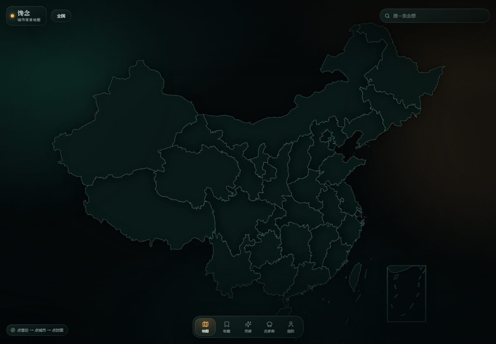
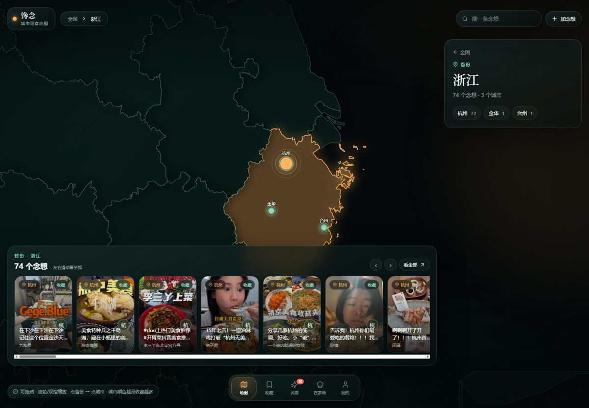

# 馋念 · 城市觅食地图

把抖音里收藏的城市、店和菜，重新放回一张可以点的地图上。

这是 **公开样例版**，包含 30 条脱敏样例数据，不包含完整收藏、账号凭据、本地采集器或抖音解析服务。

**在线演示：** https://chronosiii1124-collab.github.io/channian/

<p align="center">
  <a href="https://chronosiii1124-collab.github.io/channian/">
    
  </a>
</p>

## 它是什么

- 进入先看到中国地图，点两次省份进入城市
- 收藏的念想按城市/省份落点，点城市看该市封面
- 支持“粘链接加入念想”：自动识别标题、城市、封面
- 地点待定会集中到灵感页，支持滑动选省市或地图点选
- 有批量选地点、批量清除、回收站
- 五套视觉主题：玻璃、胶片、磨砂、米纸等
- 详情页可导航、可手动改地点/地址
- PWA、离线状态、封面骨架屏

## 截图

| 地图 | 收藏 |
|---|---|
|  |  |

| 灵感 / 地点待定 | 首次引导 |
|---|---|
|  |  |

| 城市热力 / 标签 | 文字版菜谱 |
|---|---|
|  |  |

## 功能明细

- **地图优先**：全国 → 省 → 市，第一次点亮，第二次放大
- **城市热力**：收藏越多的城市颜色越深、点越大；城市名直接显示
- **省名简化**：地图只显示“浙江/新疆/内蒙古”这类短名，不再堆全称
- **做饭视频**：详情页点“AI 生成文字版菜谱”，再进入带步骤勾选、食材、emoji 的文字版
- **自动识别**：本地版支持粘贴抖音链接，自动取标题/城市/封面
- **地点修正**：自动识别的城市或地址错了，详情页可“改地点”
- **地点待定**：灵感页独立分组 + 小红标；支持单条/批量选地点
- **清理**：批量清除、回收站、恢复、彻底删除
- **搜索**：独立搜索结果页，带最近搜索和热门城市
- **主题**：4 套质感主题，统一保证文字对比
- **主题样式**：`src/styles.css`，主题变量和地图配色在 `src/themes.js`
- **PWA**：`manifest.webmanifest` + Service Worker，可添加到主屏幕
- **手机**：两列封面、底部 Dock、地图拖动/双指缩放

## 技术栈

- React 19 + Vite 7
- ECharts 6 中国地图
- Framer Motion
- lucide-react
- 本地优先：数据在 `public/data.sample.json`，用户新增/改地点/回收站写 localStorage

## 菜谱分析说明

详情页的“AI 生成文字版菜谱”是交互入口：点击后先显示分析状态，再把步骤、食材和提示展开，可以逐步勾选。

当前公开演示内置了 5 道菜的示例分析结果（东北饭包、肉末豆角拌饭、椒盐虾仁、穷鬼拌面、新疆抓饭），用于展示交互和排版；正式接入视频转写/LLM 分析后，才能覆盖所有做饭视频。未内置的菜谱会提示需要接入分析服务。

## 本地运行

```bash
npm install
npm run dev:public
```

如果你本地有完整 `public/data.json`，用 `npm run dev` 可以看完整版。

## 构建

完整本地版：

```bash
npm run build
```

公开样例版：

```bash
npm run build:public
```

`build:public` 使用 `public/data.sample.json`，并在构建后删除 `dist-public/data.json`，避免把完整数据带进公开产物。GitHub Pages 由 `.github/workflows/pages.yml` 自动构建和部署。

## 公开数据

`public/data.sample.json`：

- 30 条
- 20 个不同城市
- 10 条地点待定（其中 6 条非菜谱）
- 6 条在家做
- 来源：收藏 17 条、聊天分享 13 条
- 已去掉 `date` 字段

完整 261 条 `public/data.json` 只在本地使用，已在 `.gitignore` 中忽略。

## 隐私

样例数据不含手机号、邮箱、身份证号、Cookie、token 或账号密码；仍包含公开视频的标题、作者、封面 URL 和城市线索。第三方内容的版权归原作者，公开演示前请自行确认使用范围。

## 部署

仓库已配置 GitHub Pages：

- `build:public` 生成静态产物
- `scripts/prune-public.mjs` 删除完整 `data.json`
- GitHub Actions 上传 `dist-public/` 并部署 Pages

## License

代码许可证暂未指定；添加许可证前请不要默认可以商用或再分发。
